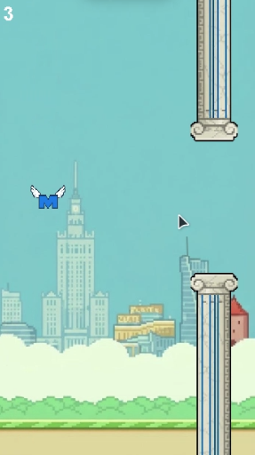

# Merito Tap

> Tap to fly. Dodge the obstacles. Beat your high score.

[]()
[]()
[]()
[](LICENSE)

## About

**Merito Tap** is a fast, simple one-tap arcade game. Guide your character through a stream of obstacles, one tap at a time. Each gap you pass earns a point, and one mistake ends the run. It is easy to learn, hard to master, and built for quick "one more try" sessions.

## Features

- One-tap controls that anyone can pick up in seconds
- Endless gameplay with gradually increasing difficulty
- Local high score saved between sessions
- Smooth, responsive physics
- [Unlockable characters or skins] - to come
- [Daily challenges or leaderboards] - to come maybe ....?

## Screenshots

| Menu | Gameplay | Game Over |
| ---- | -------- | --------- |
|  |  |  |

## How to Play

1. Tap (or click / press Space) to make your character jump.
2. Let gravity pull you down between taps.
3. Fly through the gaps without touching obstacles, the ground, or the ceiling.
4. Each gap passed scores 1 point.
5. Try to beat your best score.

## Controls

| Platform | Action |
| -------- | ------ |
| Mobile | Tap the screen |
| PC / Web | Left click or Space |
| Pause | [Esc / Pause button] |

## Getting Started

### Requirements

- [VS code, or a working Java IDE]
- Git

### Installation

```bash
git clone https://github.com/AndriiSynytsia/Merito_Tap.git
cd merito-tap
```

Then open the project in [your engine] and load the scene `[Scenes/MainMenu]`.

### Running the Game
1. Open the project in VScode, InteliJ or other programs able to run Java.
2. copy the code.
3. Click Run.

## Project Structure

```
Merito/
├── .vscode/
├── bin/
├── lib/
├── src/
|   ├── assets/
|   |    ├── bottompillar.png              # Game image
|   |    ├── meritodwn.png                 # Game image
|   |    ├── mertotapbg.png                # Game image
|   |    ├── meritoup.png                  # Game image
|   |    ├── toppillar.png                 # Game image
|   ├── main/
|   |    ├── Merito.java                   # Frame code
|   |    ├── MeritoBird.java               # Game code
├── LICENSE                  # MIT license for the game
├── Merito_Tap.iml           # ...
└── README.md                # Info about the game
```

## Tech Stack

- **Engine:** Java IDE running & debugging
- **Language:** Java
- **Art:** Paint.NET

## Roadmap

- [x] Core tap-to-fly mechanic
- [x] Obstacle spawning and scoring
- [x] High score saving
- [ ] Proper flying animation
- [ ] Main menu and settings
- [ ] Highscore

## Known Issues

- [List any current bugs or limitations here]

## Contributing

Contributions, ideas, and bug reports are welcome.

1. Fork the repository.
2. Create a branch: `git checkout -b feature/your-feature`.
3. Commit your changes: `git commit -m "Add your feature"`.
4. Push the branch: `git push origin feature/your-feature`.
5. Open a Pull Request.

## License

This project is licensed under the [MIT] License. See the [LICENSE](LICENSE) file for details.

## Credits

- **Game design and development:** Bradley & Andrii
- **Art:** Bradley Bosinney
- **Fonts and libraries:** 

## Contact
Bradley Bosinney 
Andrii Synytsia 

Project link: https://github.com/AndriiSynytsia/Merito_Tap.git